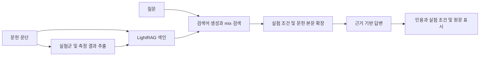

# ALD LightRAG

반도체 ALD 문헌의 실험 조건과 측정 결과를 원문 근거와 함께 비교하는 질문 서비스입니다. 답변의 인용을 누르면 해당 시료, 증착·열처리 조건, 측정값과 원문 문단을 확인할 수 있습니다.

## 주요 기능

- 공개 문헌 12편의 309개 문단 검색
- LightRAG mix 검색과 문헌 본문 확장
- 문헌별 실험군과 측정 결과 연결, 공정 조건과 측정 조건 구분
- 인용에서 실험 조건과 원문으로 이동
- Enter 전송, Shift+Enter 줄바꿈을 지원하는 웹 화면

## 실행

Python 3.12를 사용합니다.

```sh
python3 -m venv .venv
source .venv/bin/activate
pip install -r requirements.txt
export OPENAI_API_KEY='발급받은 키'
python -m lightrag_app.backend index
python -m lightrag_app.serve
```

http://127.0.0.1:8824/ 에서 질문합니다. 인증정보는 환경변수로만 읽습니다. 색인 구축과 질문에는 API 비용이 발생합니다. 최종 답변은 `gpt-6-sol`, 추출과 검색어 생성은 `gpt-6-luna`, 임베딩은 `text-embedding-3-small`을 사용하므로 해당 모델 접근 권한이 필요합니다. 모델 설정은 `provider.py`와 `lightrag_app/backend.py`에 있습니다.

API 설정 전에도 `python -m lightrag_app.serve`로 화면을 열고 저장된 실제 답변을 확인할 수 있습니다. 이 예시에는 HfO2와 Al2O3 퍼지 시간 비교 답변과 원문이 포함됩니다. 새 질문에는 키 설정과 색인이 필요합니다.

답변 아래의 실험 비교표에서 실제 인용된 측정값, 시료 및 조건을 나란히 보고 원문을 열 수 있습니다.

첫 색인 실행에서 문헌을 색인하고 실험군을 추출합니다. 생성된 색인과 캐시는 로컬에 저장되고 저장소에는 포함되지 않습니다. 같은 데이터로 색인 명령을 다시 실행하면 기존 색인을 재사용합니다.

## 구조



## 검증과 개발

```sh
python -m unittest discover -s lightrag_app -p 'test_*.py' -v
python scripts/check_public_files.py
```

자동 테스트는 근거 보존, 실험군 연결, 검색 실패 처리 등을 검사합니다. 답변의 과학적 해석은 원문 대조가 필요합니다. 두 비교 질문에서 동일 근거를 사용한 답변의 수치·조건 귀속을 확인했으며, 이는 전체 질문 정확도나 Graph RAG의 성능 우위를 의미하지 않습니다.

[개발 규칙](CONTRIBUTING.md) · [기능 명세](docs/specs/001-public-release.md) · [데이터 출처와 이용 조건](docs/SOURCES.md)

논문 본문은 문단으로 발췌·재구성한 자료이며, 각 논문의 CC BY 조건을 따릅니다. 저자와 라이선스는 출처 문서와 데이터에 기재했습니다.
