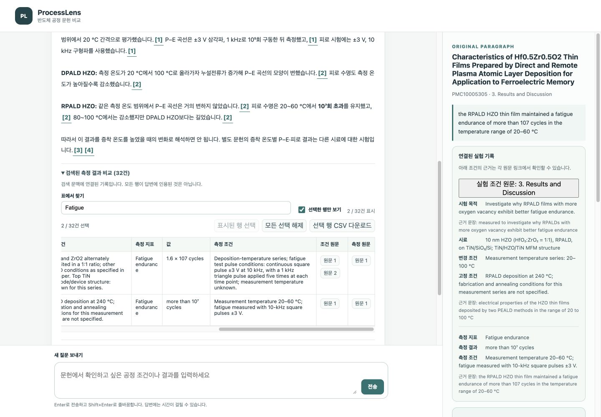
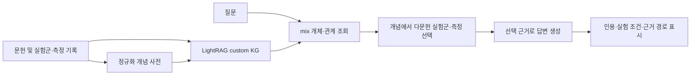

# ProcessLens

반도체 ALD 문헌에서 공정 조건과 측정 결과를 찾아 비교 자료를 만드는 서비스입니다. 질문으로 관련 실험을 찾고, 시료와 공정 조건 및 측정 조건을 나란히 검토한 뒤 선택한 결과를 원문 발췌와 함께 CSV로 저장할 수 있습니다.

## 주요 기능

- 공개 문헌 12편의 309개 문단 검색
- LightRAG가 반환한 개체와 관계에서 질문 개념을 찾아 다문헌 근거 선택
- 공통 개념 → 문헌별 실험군 → 측정값 → 원문 경로 표시
- 문헌별 실험군과 측정 결과 연결, 공정 조건과 측정 조건 구분
- 검색된 측정 기록의 선택형 비교표와 원문 문단을 포함한 CSV 내보내기
- 마지막으로 작업한 답변과 선택 행의 브라우저 저장 및 복원
- 공정 조건과 측정값의 원문을 각각 확인
- Enter 전송, Shift+Enter 줄바꿈을 지원하는 웹 화면

## 실행

Python 3.12를 사용합니다.

```sh
python3 -m venv .venv
source .venv/bin/activate
pip install -r requirements.txt
export OPENAI_API_KEY='발급받은 키'
python -m lightrag_app.backend index
python -m lightrag_app.serve
```

http://127.0.0.1:8824/ 에서 질문합니다. 인증정보는 환경변수로만 읽습니다. 색인 구축과 질문에는 API 비용이 발생합니다. 최종 답변은 `gpt-6-sol`, 임베딩은 `text-embedding-3-small`을 사용합니다. 실험군과 측정은 공개된 추출 파일을 재사용하며, 질의 개념은 정규화 사전에서 찾습니다. 모델 설정은 `provider.py`와 `lightrag_app/backend.py`에 있습니다.

API 설정 전에도 `python -m lightrag_app.serve`로 화면을 열고 저장된 실제 답변을 확인할 수 있습니다. 이 예시에는 HZO 측정 온도에 따른 P–E 곡선과 피로 수명 답변 및 원문이 포함됩니다. 새 질문에는 키 설정과 색인이 필요합니다.

## 문헌 비교 작업

1. 질문을 보내거나 저장된 예시를 엽니다.
2. 답변 아래 비교표에서 시료, 변경 조건, 고정 공정 조건, 측정 조건과 결과를 확인합니다. 표 검색과 선택한 행만 보기로 필요한 기록을 모읍니다.
3. 조건 원문과 측정 원문을 각각 열어 비교에 필요한 정보를 확인합니다.
4. 필요한 행을 선택하고 CSV로 내려받습니다. 질문, 조건, 결과, 문헌 URL, 근거 발췌와 전체 원문 문단이 함께 저장됩니다.

마지막으로 작업한 답변과 선택 행은 현재 브라우저에 저장됩니다. 새로고침하면 복원됩니다. 저장 작업 지우기로 저장본을 삭제할 수 있습니다. 다른 브라우저나 기기에는 동기화되지 않습니다.

비교표는 검색된 측정 기록을 보여주며, 각 행이 답변에서 사용되거나 서로 같은 조건에서 얻어진 결과라는 뜻은 아닙니다. 정보가 없는 항목은 추정하지 않습니다. CSV는 데이터의 영문 원문과 단위를 유지하며, 수식으로 해석될 수 있는 셀 앞에는 작은따옴표를 붙입니다. 실제 이용자의 문헌 검토 시간 절감은 아직 측정하지 않았습니다.




첫 색인 실행에서 공개된 문헌, 실험군, 측정 기록과 개념 간선을 색인합니다. 생성된 색인과 캐시는 로컬에 저장되고 저장소에는 포함되지 않습니다. 같은 데이터로 색인 명령을 다시 실행하면 기존 색인을 재사용합니다.

## 구조



## 그래프가 선택하는 근거

재료, 기판, 소자, 변경 공정 변수와 측정 지표를 [정규화 사전](config/concepts.json)으로 연결합니다. LightRAG가 검색한 원문은 먼저 보존합니다. 반환된 개체·관계와 원문에 연결된 실험·측정을 시작점으로 다른 문헌의 공통 개념을 따라 근거를 확장합니다. 질문 개념은 순위 신호로 사용하며, 범주가 빠졌다고 검색 원문을 버리지 않습니다. 논문 전체가 자동으로 추가되지는 않습니다.

현재 12편에서 개념 63개를 사용하며, 38개는 두 편 이상에 연결됩니다. 실험군 93개 중 93개에 하나 이상의 개념이 연결되고, 측정 지표는 291개 중 290개가 매핑됩니다. 범주별 미분류는 재료 2개, 기판 11개, 소자 47개, 공정 변수 4개, 지표 1개입니다. 실험군 매핑률 100%가 모든 조건의 분류 완료를 의미하지는 않습니다.

생성 인용 번호는 실제 원문 문단 하나와 대응합니다. 시료·공정 조건의 근거와 결과값의 근거가 다르면 별도로 인용하도록 합니다. 관계는 실험과 원문 연결을 나타내며 서로 다른 논문의 인과를 확정하지 않습니다.

## 기존 버전의 독립 평가

아래 수치는 근거 선택을 수정하기 전 리비전 `2803825`의 결과입니다. 현재 버전의 성능 수치로 사용하지 않습니다. 검색 구현을 읽지 않은 작성자가 만든 새로운 12개 질문을 고정한 뒤 같은 모델·프롬프트로 비교했습니다. [답변, 원문 판정과 전체 보고서](reports/evidence-preservation/README.md)를 공개합니다.

| 항목 | naive 상위 문단 | 원문 보존 + 그래프 확장 |
|---|---:|---:|
| 필수 근거 회수 및 실제 답변 | 29/45 (64.4%) | 38/45 (84.4%) |
| 수치·인용 일치 | 62/62 (100%) | 86/87 (98.9%) |
| 실행 성공 | 11/12 | 12/12 |
| 평균 문맥 토큰(성공 실행) | 3,120 | 11,892 |
| 평균 응답 시간(성공 실행) | 4.00초 | 4.70초 |

그래프는 더 많은 근거를 회수했지만 문맥과 비용도 증가했습니다. 두 방식의 실제 문맥량이 달라서 이 차이를 그래프만의 효과로 해석할 수 없습니다. 7개 필수 근거 누락과 수치 조건의 인용 불일치 1건이 남았습니다. 수치 일치율은 미답변을 포착하지 않으므로 정답률로 해석하지 않습니다. naive 실패 1건은 회수·답변 지표에 0으로 포함했습니다. 이전 전체 문헌/naive/그래프의 [15개 질문 평가](reports/README.md)는 별도로 보존하며 서로 다른 질문 집합의 점수를 직접 개선율로 계산하지 않습니다.

같은 문맥 상한에서 저장된 검색 근거를 재구성한 [보조 분석](reports/comparison-workspace/budget.md)도 제공합니다. 기존 질문과 graph 검색 시작점을 공유한 사후 분석이며, 독립적인 검색·답변 비교와 구분합니다.

## 검증과 개발

```sh
python -m unittest discover -s lightrag_app -p 'test_*.py' -v
python scripts/check_public_files.py
node --test scripts/test_comparison.cjs scripts/test_workspace.cjs
```

자동 테스트는 근거 보존, 실험군 연결, 검색 실패 처리 등을 검사합니다. 답변의 과학적 해석은 원문 대조가 필요합니다. 평가에 사용한 답변과 수치별 인용 판정은 reports/에 함께 제공합니다.

[개발 규칙](CONTRIBUTING.md) · [그래프 선택 명세](docs/specs/005-graph-evidence.md) · [데이터 출처와 이용 조건](docs/SOURCES.md)

논문 본문은 문단으로 발췌·재구성한 자료이며, 각 논문의 CC BY 조건을 따릅니다. 저자와 라이선스는 출처 문서와 데이터에 기재했습니다.
