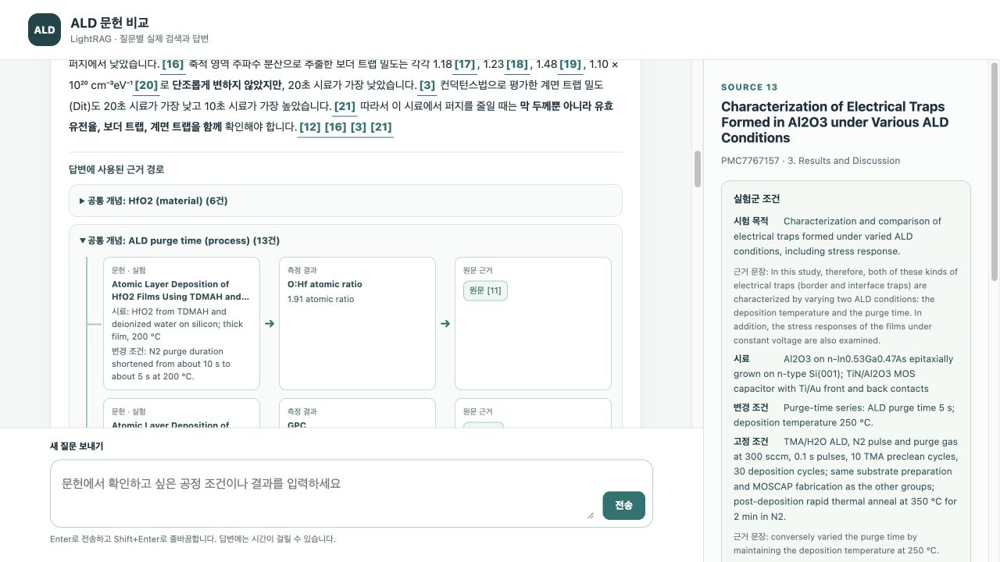
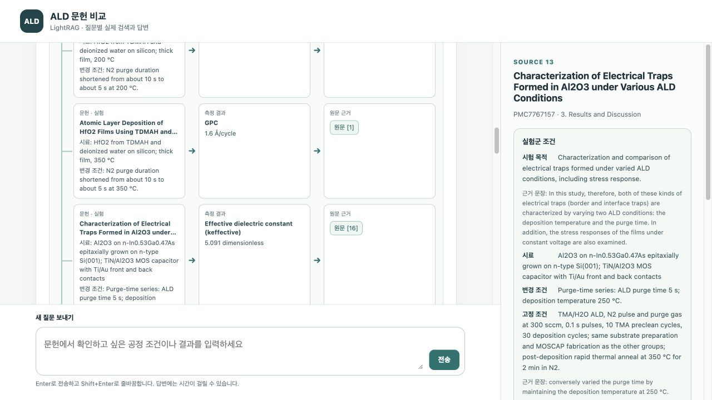

# 12편 문헌의 근거 선택 평가

이 문서는 수정 전 고정 평가입니다. 현재 구현의 별도 새 질문 검증은 [근거 보존 수정 평가](evidence-preservation/README.md)를 확인하세요.

고정한 질문 15개를 `all`, `naive`, `graph` 방식으로 한 번씩 실행한 45개 답변의 결과입니다. 질문과 필수 근거는 커밋 `be9c4b1`에, 평가 코드와 그래프 선택 구현은 커밋 `31d1cc9`에 고정했습니다. 실행 조건과 비용 계산 범위는 [고정 프로토콜](PROTOCOL.md), 행별 답변과 사용량은 [비교 원자료](comparison.json)에 있습니다.

| 방식 | 필수 측정 근거 회수율 | 수치 주장·인용 일치율 | 문맥 토큰 평균 (합계) | 질의 시간 평균 (합계) | 추정 비용 평균 (합계) |
| --- | ---: | ---: | ---: | ---: | ---: |
| all | 55/55 (100.0%) | 169/171 (98.8%) | 84,583 (1,268,745) | 4.75초 (71.30초) | $0.173183 ($2.597742) |
| naive | 25/55 (45.5%) | 104/112 (92.9%) | 3,550.53 (53,258) | 4.07초 (60.98초) | $0.010726 ($0.160897) |
| graph | 15/55 (27.3%) | 95/112 (84.8%) | 4,801.33 (72,020) | 4.08초 (61.26초) | $0.012990 ($0.194856) |

필수 측정 근거 회수율은 55개 필수 측정 각각의 인용 원문이 최종 문맥에 들어왔는지를 세었습니다. `all`은 12편 전체를 넣으므로 100%가 설계상 예상되는 결과입니다. `graph`는 전체적으로 `naive`보다 문맥과 추정 비용을 더 쓰면서 근거를 적게 회수했습니다. 두 방식의 평균 질의 시간 차이는 약 0.02초이며, 단발 실행 결과이므로 안정적인 속도 차이로 해석하지 않습니다. 45회 질의의 추정 비용 합계는 $2.953495입니다. 이는 기록된 API 사용량에 [프로토콜의 단가](PROTOCOL.md)를 적용한 값이며, 색인 구축·사전 추출, 세금, 계정 청구서의 할인은 포함하지 않습니다.

| 방식 | 단일 문헌 근거 회수 | 다문헌 근거 회수 | 숫자 주장이 없는 답변 | 인용 불일치 | 판단 보류 |
| --- | ---: | ---: | ---: | ---: | ---: |
| all | 28/28 (100.0%) | 27/27 (100.0%) | 0/15 | 0 | 2 |
| naive | 18/28 (64.3%) | 7/27 (25.9%) | 0/15 | 4 | 4 |
| graph | 4/28 (14.3%) | 11/27 (40.7%) | 3/15 | 13 | 4 |

`graph`는 다문헌 질문에서 `naive`보다 많은 필수 근거를 회수했지만, 단일 문헌 질문에서는 큰 폭으로 적었습니다. 숫자 주장이 없는 답변 3개는 Q02, Q03, Q11의 `graph` 답변입니다. Q06과 Q07의 `graph` 답변도 결과 수치를 제시하지 못했으나, 질문의 온도·시간을 되풀이해 감사 대상 숫자 주장이 남았습니다. 따라서 숫자 주장이 없는 답변 수만으로 미응답을 모두 세지는 못합니다.

수치 주장·인용 일치율은 [Q01~Q05 감사](citation-audit-01-05.json), [Q06~Q10 감사](citation-audit-06-10.json), [Q11~Q15 감사](citation-audit-11-15.json)의 `supported / (supported + unsupported + unclear)`입니다. 값과 단위, 시료, 공정·측정 조건을 해당 답변이 인용한 원문 문단에 대조했습니다. 전체 395개 수치 주장 중 368개가 인용 문단으로 뒷받침됐고, 17개는 뒷받침되지 않았으며, 10개는 판단을 보류했습니다. 이 비율은 **답변 정답률이 아닙니다.** 모델이 필요한 결과를 누락하거나 답변을 보류하면 감사할 주장 자체가 줄어들며, 이 지표는 필수 근거 회수나 질문에 대한 완결성을 측정하지 않습니다.

인용 불일치 17개는 인용된 문단에 숫자나 해당 시료·조건의 연결이 없다는 뜻입니다. 다른 원문 문단에는 있는 값도 포함됩니다. 예를 들어 Q09 `graph` 답변의 약 30 nm, 1 MHz, 85 °C, 100 nm는 실제 문헌의 다른 문단에는 있지만 답변이 붙인 문단에는 없습니다. Q14 `graph`의 시험 펄스 조건도 인용 문단에 없습니다. 이를 모두 문헌 전체에 존재하지 않는 수치로 단정할 수는 없습니다. 일부 불일치는 질문의 조건 숫자를 출처 없이 되풀이하거나 다른 공정·시료의 숫자를 연결한 경우입니다.

판단 보류 10개 중 6개는 Q06·Q07에서 답을 내지 못하면서 질문의 숫자를 다시 쓴 주장입니다. 나머지 4개는 원문만으로 특정 시료에 수치를 대응시키기 어려운 경우입니다. 판단 보류를 분모에 포함했으므로 세 방식의 일치율은 이를 성공으로 계산하지 않습니다. 답변과 인용의 실제 문장별 판단은 위 감사 파일에서 확인할 수 있습니다.

집계는 `python3 evaluation/summarize.py`로 재현할 수 있습니다. 이 스크립트는 15개 질문 × 3방식과 방식별 필수 측정 55개, 감사 파일의 대응 관계를 검사하며 API를 호출하지 않습니다.

## 원문 대조와 화면 확인

수치 주장은 세 독립 에이전트가 질문 구간을 나누어 원문과 대조했습니다. 분야 전문가의 정답 판정은 아니며, 판정 문장과 인용 문단 ID를 공개해 재검토할 수 있게 했습니다. 구현의 자동 테스트와 생성 답변의 품질 평가는 구분합니다.

Q08의 저장된 그래프 답변에서 공통 퍼지 시간 개념 아래 HfO2와 Al2O3의 실험군·측정 경로를 확인했습니다. 유전율 5.091을 누르면 5초 퍼지, 250 °C 증착 조건과 해당 원문이 열립니다.

## 독립 구현 검토

개념 선택과 평가 로직을 구현하지 않은 검토 에이전트가 SPEC, backend, selection, concepts와 평가 자료를 대조했습니다. 45개 고유 실행, 고정 질문·문헌·실험 데이터의 불변, 통계 및 비용 산식, 공개 파일의 인증정보·개인 경로 제외를 확인했고 병합을 막는 결함은 발견하지 않았습니다. UI 작성자는 자신의 UI 변경을 이 독립 검토 범위에서 제외했습니다. 화면에서 측정값을 눌러 원문을 여는 동작은 별도로 확인했습니다.
