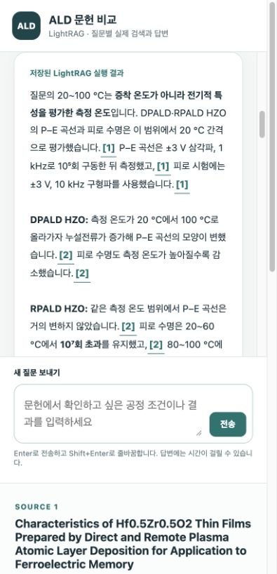
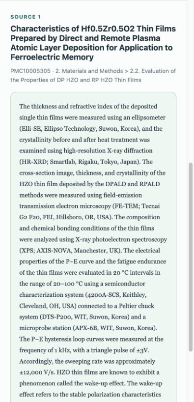

# 검색 근거 보존 수정의 독립 검증

범주 AND 필터와 빈 개념 차단을 제거하고, SDK 검색 원문을 먼저 보존하도록 수정했습니다. 검색한 Methods 문단에서도 같은 실험의 측정 결과를 연결합니다. 개념은 확장과 순위 신호이며 검색 근거를 버리는 조건으로 사용하지 않습니다. 생성 모델에는 원문 문단을 중복 없이 전달하므로 여러 문단의 실험 조건을 하나의 측정 인용에 합치지 않습니다.

구현은 `c53096c`, 새 질문은 `2edea40`에서 고정했습니다. 질문 작성자는 검색 구현을 읽지 않았습니다. 원문 12편, 실험군 93개, 측정 291개, 정규화 사전은 그대로입니다. [고정 입력](frozen-inputs.json), [질문](../../evaluation/questions-007.json), [프로토콜](PROTOCOL.md)을 공개합니다.

| 항목 | LightRAG naive | 원문 보존 + 그래프 확장 |
|---|---:|---:|
| 실행 성공 | 11/12 | 12/12 |
| 필수 근거 회수(실패는 0) | 29/45 (64.4%) | 38/45 (84.4%) |
| 필수 측정을 실제로 답변 | 29/45 (64.4%) | 38/45 (84.4%) |
| 수치 주장과 인용 문단 일치 | 62/62 (100%) | 86/87 (98.9%) |
| 검색 원문 보존(성공 실행) | 110/110 | 120/120 |
| 평균 문맥 토큰(성공 실행) | 3,120 | 11,892 |
| 평균 응답 시간(성공 실행) | 4.00초 | 4.70초 |
| 성공 실행의 사용량 기반 비용 합계 | $0.07706 | $0.24271 |

새 질문 집합에서 그래프는 필수 근거와 실제 답변을 더 많이 확보했지만 문맥과 비용도 더 사용했습니다. 두 집합이 다르므로 이전 15개 평가의 27.3%와 이번 84.4%를 직접적인 개선율로 계산하지 않습니다. 각 방식의 단발 실행이며, 이 결과만으로 모든 질문의 우위를 주장하지 않습니다.

## 판정 범위

필수 근거 회수는 해당 측정의 모든 필수 원문이 최종 문맥에 있는지를 셉니다. 답변 충족은 독립 검토자가 실제 답변의 값·단위·시료·조건을 확인한 결과입니다. 45개에는 온도에 따른 P–E 곡선 변화처럼 정성적인 측정 결과도 포함됩니다.

수치 일치율은 원문에 붙인 인용을 대조한 수치 주장만 셉니다. 질문 숫자의 단순 재진술과 정성 설명은 분모에서 제외하고 notes에 기록합니다. 답변이 누락된 경우에는 숫자 주장이 적어지므로 이 비율만으로 품질을 판단하지 않습니다. [H01–H06 판정](audit-01-06.json)과 [H07–H12 판정](audit-07-12.json), [실제 답변·사용량](comparison.json)을 함께 제공합니다. 두 독립 에이전트의 원문 대조이며 분야 전문가의 검증으로 표현하지 않습니다.

## 확인한 개선과 남은 문제

- H05: naive가 놓친 HfO2의 500사이클 XRR 두께 3개를 그래프 답변이 모두 설명했습니다.
- H08: naive가 놓친 3C-SiC 시료의 평탄대 전압 2개를 그래프 답변이 설명했습니다.
- H11: naive가 놓친 InGaAs 시료의 누설전류 밀도 2개를 그래프 답변이 설명했습니다.
- H06: 두 방식 모두 La-Al-O의 밴드 오프셋 및 누설전류 필수 근거 4개를 놓쳤습니다. 원문 p0014 자체에도 두 산화제의 누설전류 수치 순서와 뒤의 비교 설명이 충돌합니다. 회수 실패와 원문 충돌은 별개입니다.
- H07 graph: 두꺼운 HfO2 막의 유전율 범위를 놓쳤습니다. 300°C 시료와 42.2nm 두께를 연결한 문장에는 두께 문단만 인용했고, 온도 대응을 확인하는 추가 문단의 인용이 빠졌습니다. 값이 문헌 어딘가에 있다는 이유로 인용 일치로 처리하지 않았습니다.
- H09: 두 방식 모두 Al2O3 XPS 결합 에너지 근거 2개를 놓쳤습니다.
- H07 naive는 RuntimeError로 답변을 반환하지 못했습니다. 이 실행의 단계별 오류 원인과 사용량이 저장되지 않아 원인과 청구액을 추정하지 않습니다. 실패를 0으로 포함한 회수율 외에, 성공한 11개만의 근거 회수는 29/42(69.0%)입니다.

범주 차단으로 검색 원문이 사라지는 결함과 구조화 청크의 인용 범위 혼합은 수정됐습니다. 남은 7개 필수 근거 누락은 후속 검색·순위화 과제이며, 인용 불일치 1건도 남아 있습니다. 이를 숨기기 위해 정답을 코드에 넣거나 인용 번호를 자동으로 덧붙이지 않았습니다.

## 검증 및 비용 범위

결정적 회귀 테스트 20개를 통과했습니다. 독립 코드 검토에서 발견한 Methods 연결 누락 및 평가 파일 혼합 문제를 수정한 뒤 최종 평가를 시작했습니다. 실행 후 검색 코드, 프롬프트, 사전과 질문을 변경하지 않았습니다. `python evaluation/check007.py`가 고정 파일 해시, 24개 실행/감사 대응, 정답 ID, 인용 원문 범위 및 검색 원문 보존을 검사하고 표를 재계산합니다.

최종 성공 실행 23건의 기록된 비용 합계는 $0.31976436입니다. 초기 중단 전 완료 8건의 $0.14460736을 더한 확인 가능한 사용량 기반 금액은 $0.46437172입니다. 초기 중단 중 1회와 최종 실패 1회의 청구액은 확인되지 않아 총 청구액으로 표현하지 않습니다. 생성 시도는 초기 최대9회와 최종24회로 전체36회 상한 안이며 추가 재생성은 하지 않았습니다.

## 직접 확인

저장된 HZO 질문에서 측정 온도와 증착 온도를 구분한 답변을 열고 시험 조건의 인용을 누르면 해당 Methods 원문으로 이동합니다. 경로는 인용 문단에 연결된 측정으로 표시하며 문단의 모든 측정을 답변이 사용했다고 단정하지 않습니다. 실험 조건은 별도의 원문 링크로 확인할 수 있습니다.

